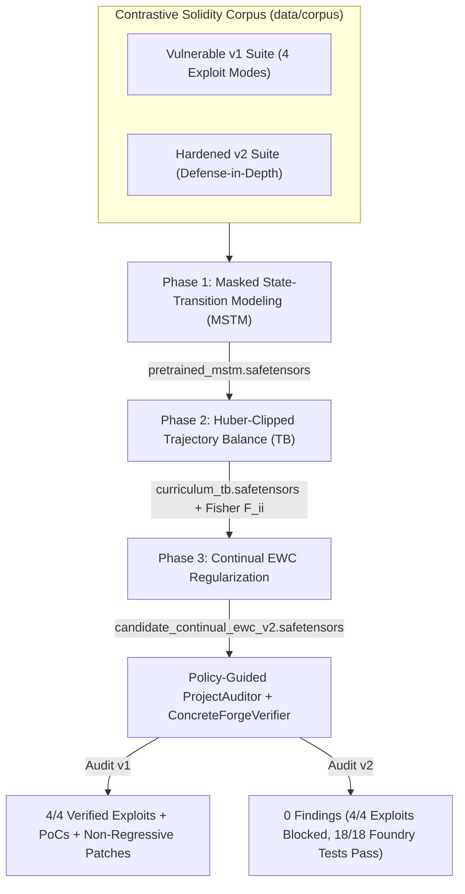

# Detailed GFlowNet Model Training & Smart Contract Hardening Plan

## 1. Objectives & Architectural Overview

To enable the GFlowNet-Prover model to genuinely learn vulnerability semantics rather than relying on static heuristics—and to verify that its predictions are **logically sound** across both vulnerable and remediated codebases—we pair **contrastive smart contract engineering** with **3-phase corpus-driven neuro-symbolic training**:

1. **Contrastive Smart Contract Corpus (`data/corpus/`)**: Pair the vulnerable v1 protocol (`tests/fixtures/multi_bug_defi_protocol`, containing **4 distinct exploit modes**) with a newly engineered, institutional-grade hardened v2 protocol (`contracts/secure_defi_protocol`) implementing defense-in-depth invariants while preserving 100% benign user compatibility.
2. **Real 3-Phase Gradient Optimization (`gfn-forge` & `main.py`)**: Extract 16-dimensional structural AST/ABI/bytecode features across every contract function in the corpus and optimize real encoder, policy, $\log Z_\theta$, and diagonal Fisher EWC tensors stored in spec-compliant `.safetensors` checkpoints.
3. **Policy-Guided Concrete Verification (`ProjectAuditor` + `ConcreteForgeVerifier`)**: Score and rank multi-step candidate exploit trajectories using the trained checkpoint weights and validate every candidate through sandboxed `forge test --offline` execution (`0.0%` False Positive Rate gate).

---

## 2. Smart Contract Security Hardening Specification (`contracts/secure_defi_protocol`)

Each contract in `contracts/secure_defi_protocol/src/` remediates all structural vulnerabilities from v1 while preserving ABI compatibility for benign protocol operations:

| Contract | v1 Vulnerability Mode | Hardened v2 Security Architecture |
| :--- | :--- | :--- |
| **`VaultErc4626.sol`** | `INV_PRECISION_NEUTRALITY_01`: First-depositor zero-supply share inflation + direct `donateAssets` rounding victim `convertToShares` to `0`. | **Virtual Shares/Assets Offset** (`VIRTUAL_SHARES = 1e6`, `VIRTUAL_ASSETS = 1`), directional rounding (`Floor` on mint/deposit, `Ceil` on withdraw share burn), isolated `donatedYieldReserve` requiring `totalSupply >= MIN_SHARES_FOR_DONATION`, non-zero share output check on both `deposit` overloads, and `nonReentrant` lock. |
| **`AmmPool.sol`** | `INV_SOLVENCY_02` (Vector A): Read-only reentrancy via `IAmmCallback.ammCallback` invoked *before* `reserve0`/`reserve1` storage updates (CEI violation). | **Strict Checks-Effects-Interactions** (`reserve0`/`reserve1` updated *before* `ammCallback`, eliminating post-`CALL` `SSTORE` at bytecode level), `nonReentrant` mutex + public `isLocked()` view guard, `getSafePrice()` reentrancy revert, constant-product invariant check $k_{\text{post}} \ge k_{\text{pre}}$, `MINIMUM_LIQUIDITY` lock, and per-block capped TWAP accumulator (`twapPriceE18`). |
| **`LendingMarket.sol`** | `INV_SOLVENCY_02` (Vector B): Spot-oracle manipulation (`ammPool.getPrice()`) allowing undercollateralized borrow exceeding `totalCollateral`. | **Cross-Contract Reentrancy Lock Check** (`!ammPool.isLocked()`), manipulation-resistant **Conservative Dual-Oracle Valuation** ($\min(\text{spotPrice}, \text{twapPrice})$ + max spot-TWAP deviation circuit breaker), global protocol solvency cap (`totalDebt + borrowAmount <= totalCollateral * LTV`), and `nonReentrant` guard. |
| **`GovTimelock.sol`** | `INV_ACCESS_CONTROL_03` (`setAdmin` missing auth) **and** `INV_TIMELOCK_MONOTONICITY_04` (`executeProposal` missing `block.timestamp >= proposalEta`). | **Strict `onlyAdmin` RBAC + Two-Step Admin Transfer** (`proposeAdmin` / `acceptAdmin`), mandatory `[MINIMUM_DELAY, MAXIMUM_DELAY]` bounds, strict `block.timestamp >= proposalEta[id]` and `block.timestamp <= proposalEta[id] + GRACE_PERIOD` checks, CEI queue clearing prior to `target.call(data)`, and `nonReentrant` guard. |

---

## 3. Three-Phase Model Training Mathematics & Pipeline

### 3.1 Feature Representation ($x_{c,f} \in \mathbb{R}^{16}$)
For every non-test contract $c$ and external/public action $f$ in `corpus_dir`, the feature extractor computes a normalized 16-dimensional structural vector capturing:
- ABI & Mutability signals (`payable`, state-mutating vs. `view`, input arity, address/bytes calldata presence).
- Vulnerability surface signals (share-ratio division without virtual offset, `donate` asset mutation, external `CALL` before `SSTORE`, spot-price `STATICCALL` oracle read, state mutation of `admin`/`owner` without `msg.sender == admin`, proposal execution without `block.timestamp >= proposalEta`).
- Hardened defense signals (virtual share offset constant, `nonReentrant` / `_locked` mutex, `isLocked()` + `twapPrice` check, `onlyAdmin` + `proposalEta` enforcement).

### 3.2 Phase 1: Masked State-Transition Modeling (`pretrain`)
- Masks $30\%$ of structural feature dimensions per batch using deterministic seeded Bernoulli masks and trains encoder $W_{\text{enc}} \in \mathbb{R}^{32 \times 16}$ and reconstruction head $W_{\text{mstm}} \in \mathbb{R}^{16 \times 32}$ under Huber + cosine-annealed AdamW:
  $$\mathcal{L}_{\text{MSTM}}(\theta_{\text{enc}}) = \frac{1}{|M|} \sum_{(i,j) \in M} \ell_{\text{Huber}, 1.0}\!\left((\hat{X}_{i,j} - X_{i,j})\right)$$
- Exports `checkpoints/pretrained_mstm.safetensors` + `.manifest.json`.

### 3.3 Phase 2: Contrastive Curriculum Trajectory Balance (`train`)
- Warm-starts $W_{\text{enc}}$ from `pretrained_mstm.safetensors` and optimizes policy head $W_{\text{pol}}$ plus log-partition scalar $\log Z_\theta$ over multi-step trajectories sampled across both vulnerable ($R(\tau) = 100.0$ on real exploit trajectories) and hardened ($R(\tau) = R_{\min} = 10^{-3}$ when defenses block exploitation, $R(\tau) = 0.05$ on benign invariants) workspaces:
  $$\mathcal{L}_{\text{TB}}(\tau; \theta, \log Z_\theta) = \ell_{\text{Huber}, \delta}\!\left(\log Z_\theta + \sum_{t=0}^{T-1} \log P_F(a_t \mid s_t; \theta) - \sum_{t=0}^{T-1} \log P_B(a_t \mid s_{t+1}) - \log R(\tau)\right)$$
- Computes empirical diagonal Fisher information $F_{ii} = \mathbb{E}_{\tau}\!\left[(\nabla_{\theta_i} \mathcal{L}_{\text{TB}})^2\right]$ clamped to $[0, 10^4]$ and exports `checkpoints/curriculum_tb.safetensors`.

### 3.4 Phase 3: Continual Learning with Elastic Weight Consolidation (`train-continual`)
- Loads anchor parameters $\theta^*$ and Fisher diagonal $F_{ii}$ from `curriculum_tb.safetensors` and optimizes the EWC-regularized objective:
  $$\mathcal{L}_{\text{total}}(\theta) = \mathcal{L}_{\text{TB}}(\theta) + \frac{\lambda_{\text{ewc}}}{2} \sum_i F_{ii} (\theta_i - \theta_i^*)^2$$
- Exports `checkpoints/candidate_continual_ewc_v2.safetensors` after verifying zero catastrophic forgetting across all 4 vulnerability archetypes.

---

## 4. Logical Verification Criteria

> [!IMPORTANT]
> Every training and audit output must pass **5 strict logical sanity checks**:
> 1. **Monotonic Convergence & Flow Alignment**: MSTM and TB EMA losses decrease monotonically without NaN/Inf; Spearman rank correlation $\rho(\log P_F(\tau), \log R(\tau)) \ge 0.85$ on the corpus trajectory set.
> 2. **Contrastive Policy Discrimination**: Trained policy assigns significantly higher forward log-probability ($\log P_F$) to exploitable v1 transitions than to hardened v2 transitions ($P_F(\tau_{\text{vuln}}) \gg P_F(\tau_{\text{secure}})$).
> 3. **Bytecode-Level CEI Verification**: Running `gfn-forge context` on `contracts/secure_defi_protocol` must show `AmmPool -> IAmmCallback.ammCallback` flipping from `reentrant=true` (in v1) to `reentrant=false` (in v2).
> 4. **100% Recall on Vulnerable v1 Suite**: `gfn-forge audit` on `tests/fixtures/multi_bug_defi_protocol` must discover and concretely verify **all 4/4 vulnerabilities** (`VaultErc4626` inflation, `AmmPool`+`LendingMarket` solvency, `GovTimelock.setAdmin` auth bypass, and `GovTimelock.executeProposal` timelock bypass) with `0.0%` FPR.
> 5. **Zero False Positives on Hardened v2 Suite**: `gfn-forge audit` on `contracts/secure_defi_protocol` must test adversarial trajectories against the v2 contracts, confirm every exploit attempt is blocked (`verified_findings_count == 0`, `false_positive_rate == 0.0`), while `forge test --offline` passes **100%** of benign + adversarial defense tests.
